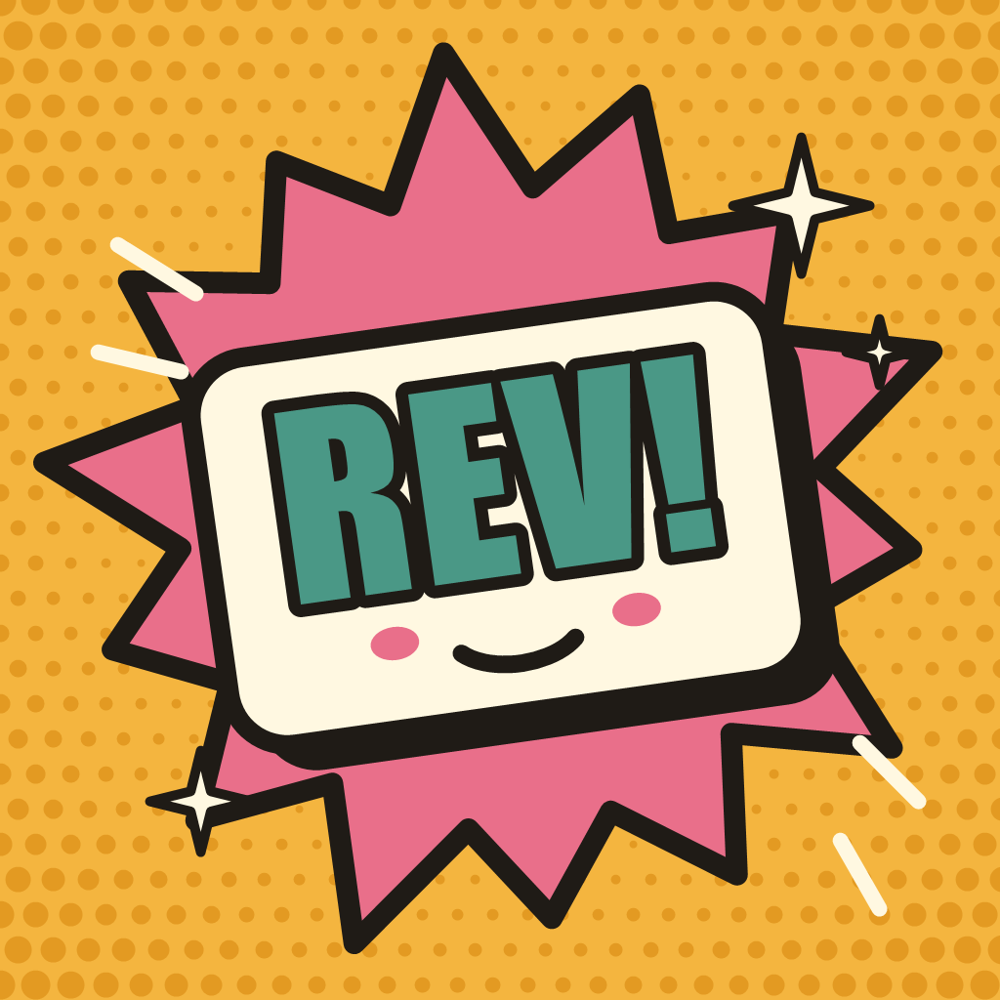
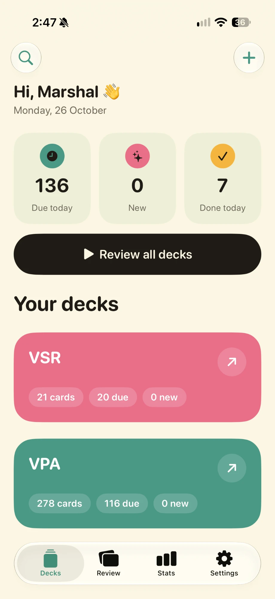
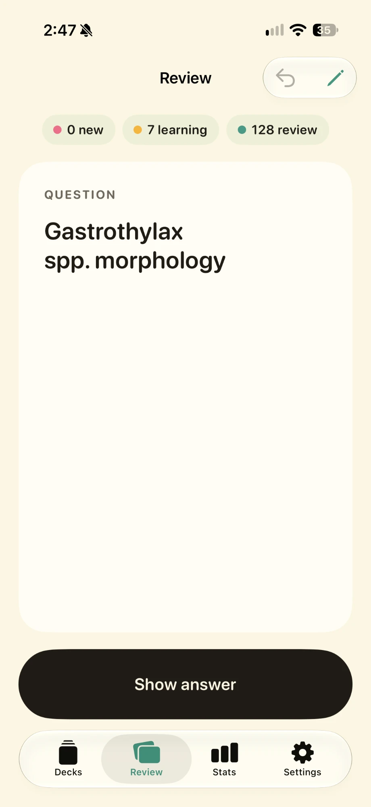
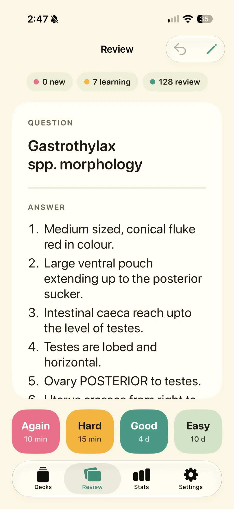
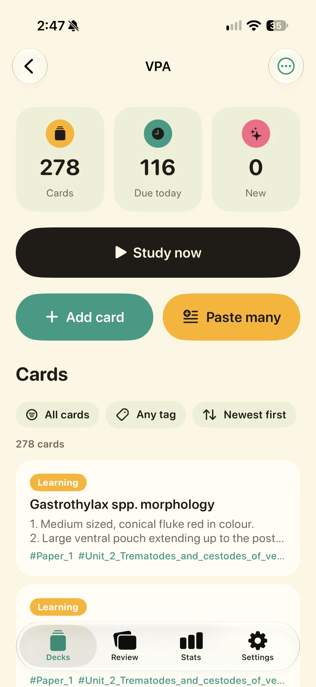
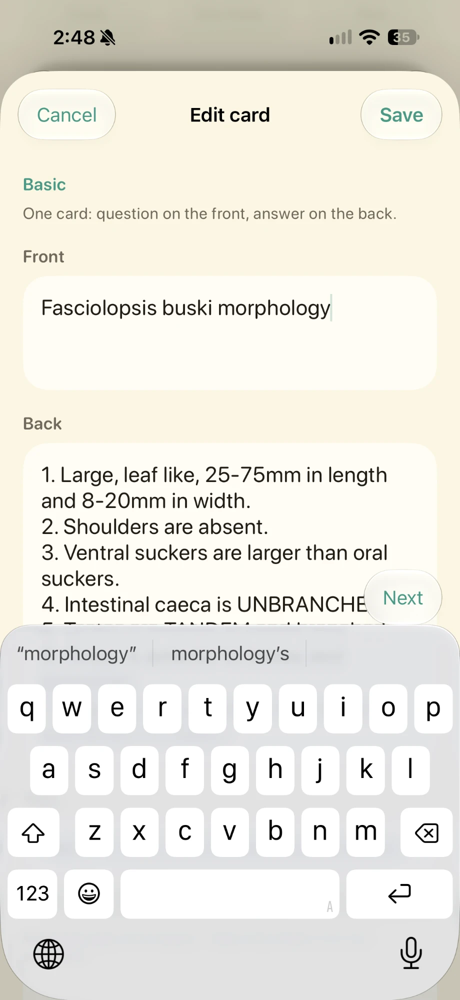
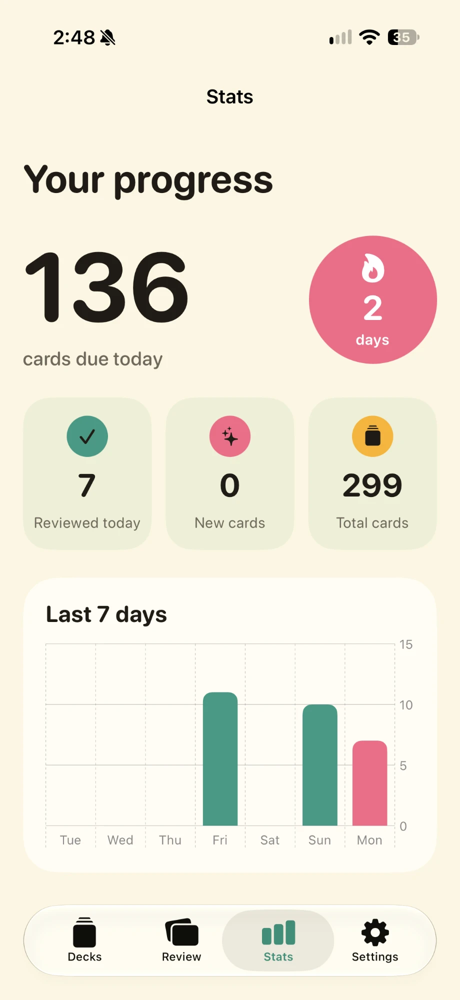

<p align="center">
  
</p>

<h1 align="center">Rev</h1>

<p align="center">
  <b>A calm, thumb-friendly spaced-repetition flashcard app for iPhone.</b><br>
  Built for studying veterinary medicine, with smart FSRS scheduling and two-way sync with Anki.
</p>

<p align="center">
  <a href="https://github.com/NevamindHaze/Rev/actions/workflows/ios-build.yml"></a>
  <a href="https://github.com/NevamindHaze/Rev/releases/latest"></a>
  
  
</p>

## Screenshots

<!-- Each screenshot follows GitHub's light/dark theme. -->
<p align="center">
  <picture><source media="(prefers-color-scheme: dark)" srcset="docs/screenshots/dark/01-decks.png"></picture>
  <picture><source media="(prefers-color-scheme: dark)" srcset="docs/screenshots/dark/02-review-question.png"></picture>
  <picture><source media="(prefers-color-scheme: dark)" srcset="docs/screenshots/dark/03-review-answer.png"></picture>
</p>
<p align="center">
  <picture><source media="(prefers-color-scheme: dark)" srcset="docs/screenshots/dark/04-deck.png"></picture>
  <picture><source media="(prefers-color-scheme: dark)" srcset="docs/screenshots/dark/05-editor.png"></picture>
  <picture><source media="(prefers-color-scheme: dark)" srcset="docs/screenshots/dark/06-stats.png"></picture>
</p>

<p align="center"><sub>Your decks · Question · Answer with four big buttons · Inside a deck · Card editor · Stats</sub></p>

## Features

**Studying**
- Minimal review screen: tap to reveal, then four big buttons (Again · Hard · Good · Easy) that show when you'll see the card next
- **FSRS** scheduling with an adjustable memory target, or classic **SM-2**
- Learning steps, overdue credit, interval fuzz, sibling burying and a 4 am day rollover, like Anki
- Undo, edit-while-reviewing, leech detection with rewrite/suspend suggestions

**Cards**
- Card types: **Basic**, **Basic + reversed**, **Cloze** (fill in the blank) and **Type the answer**
- Tags with suggestions, a card browser with filters (due, new, learning, leeches, suspended, tag) and sorting
- Images with tap-to-zoom, neat bullet and numbered lists, “paste many” for quick bulk entry

**Anki**
- Import any `.apkg` or `.colpkg` (old or newest format) with text, images, progress, tags and suspended cards
- Export decks back to Anki
- **Two-way sync** with Anki on your computer through iCloud Drive and the included [Rev Sync add-on](anki-addon/) — reviews, edits, new cards, tags and deletions in both directions, without touching AnkiWeb's protocol

**Progress and safety**
- Stats: cards due, reviews today, streak, last 7 days
- JSON backup and restore through the Files app
- Dark mode, warm colours, large rounded type

## Install (SideStore)

Rev is a personal app distributed as an unsigned build for sideloading.

1. In **SideStore**, go to **Sources → +** and add:
   ```
   https://github.com/NevamindHaze/Rev/releases/latest/download/source.json
   ```
2. Open **Rev** in the source and tap **Install**. New versions appear as updates, with release notes.

## Sync with Anki

```
Rev (iPhone)  ⇄  iCloud Drive / "Rev Sync"  ⇄  Rev Sync add-on (Anki on your computer)  ⇄  AnkiWeb
```

1. Copy [`anki-addon/rev_sync`](anki-addon/rev_sync) into Anki's `addons21` folder and restart Anki. It makes a backup before its first sync.
2. In Rev, open **Settings → Sync with Anki** and choose the **Rev Sync** folder in iCloud Drive.

Each card is matched by its Anki note and card number. Text and schedule are merged separately — whichever app changed it most recently wins — and review history from both apps is kept.

## How it's built

| | |
|---|---|
| UI and storage | SwiftUI, SwiftData (iOS 18+) |
| Project | Generated by [XcodeGen](https://github.com/yonaskolb/XcodeGen) from [`project.yml`](project.yml) |
| Builds | GitHub Actions on macOS: every push to `main` builds an unsigned IPA and publishes a release + SideStore source |
| Libraries | [ZIPFoundation](https://github.com/weichsel/ZIPFoundation), [zstd](https://github.com/facebook/zstd) |
| Release notes | [`RELEASE_NOTES.md`](RELEASE_NOTES.md) — shown in SideStore and on each GitHub release |

```
Rev/App          app start, tabs, sync triggers
Rev/Models       Deck, Card, ReviewLog, card kinds and tags
Rev/Scheduling   FSRS, SM-2, study queue
Rev/Sync         two-way Anki sync (file format, merge rules, iCloud access)
Rev/Anki         .apkg / .colpkg import and export
Rev/Backup       JSON backup and restore
Rev/Views        all screens
anki-addon       the Rev Sync add-on for Anki desktop (+ tests)
```
